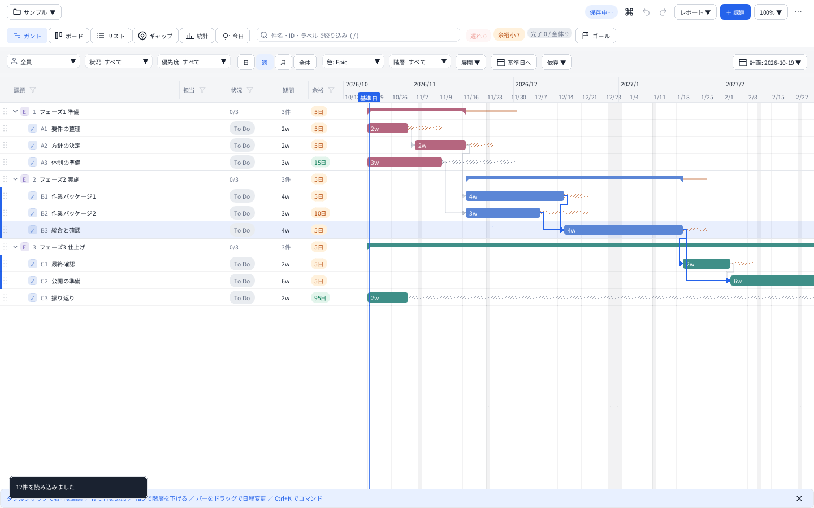
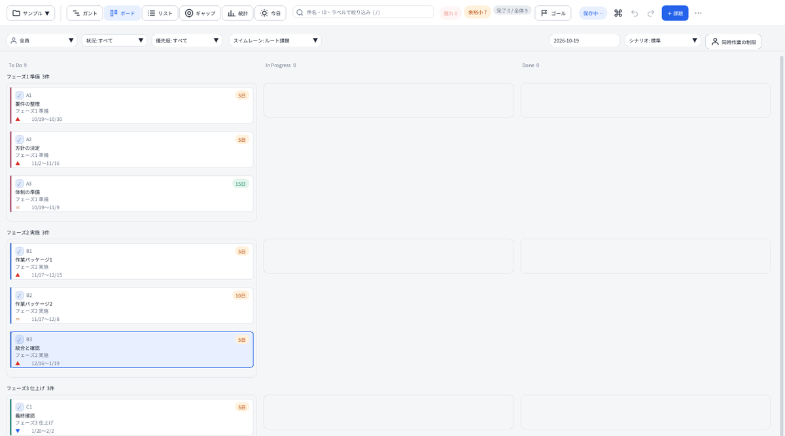
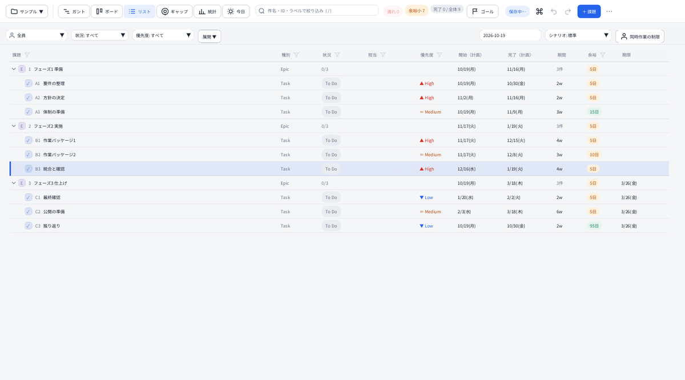
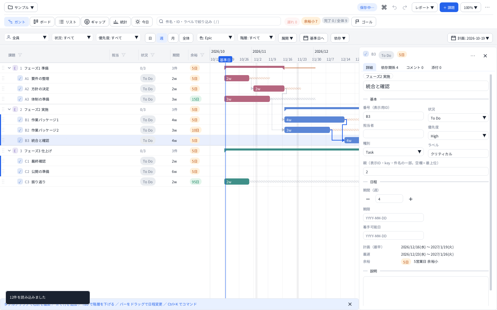
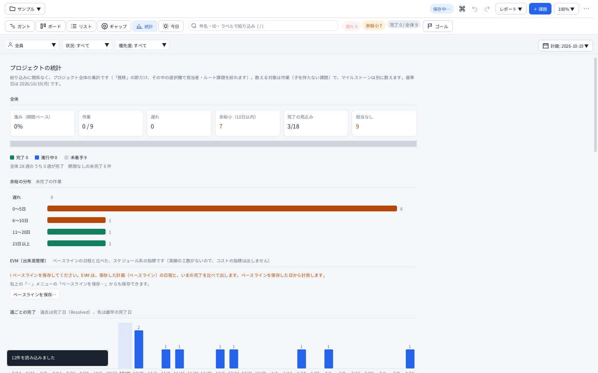

# Cairn

**オフラインで動く、JIRA 互換のガント／スケジューラ。営業日・余裕の計算、週報、ベースライン比較**

*A signpost for your schedule — an offline, JIRA-compatible Gantt chart and scheduler for Windows.*



[日本語](#日本語) ・ [English](#english)

---

## 日本語

Cairn（ケルン）は、登山道で道しるべに石を積んだもの。マイルストーン（道しるべ）を積み上げて進む、という意味で名づけました。

JIRA 互換の CSV を原本に、課題の階層・依存関係・期間から **営業日ベースの日程（最早・最遅・余裕）** を自動で計算し、
ガント・ボード・リスト・ギャップ（ゴール）・統計・今日（今日と今週にやること）で見ながら編集する Windows 用のデスクトップアプリです。
ブラウザ版を C++ で作り直し、日程計算と CSV の互換性を保ちながら機能を追加しています（詳細: [仕様書](docs/SPEC.md)）。
（以前の名前は「プロジェクト管理ツール」「Project Roadmap」です。設定・データの名前と場所は変わっていないので、そのまま使えます。）

### ダウンロード

[Releases](https://github.com/Hidenori24/cairn/releases/latest) から取ります。対象は Windows 10/11 x64 です。

| 配布物 | 中身 |
|---|---|
| `Cairn-Setup-<版>.exe` | インストーラ。管理者権限なしで入ります。今までの版の上に上書きして更新できます |
| `Cairn-windows-x64.zip` | ポータブル版。展開して `Cairn.exe` を実行するだけ（インストール不要） |
| `SHA256SUMS.txt` | 上のファイルのチェックサム。`certutil -hashfile <ファイル> SHA256`（PowerShell なら `Get-FileHash`）で照合できます |

`-rc` が付いた版（`1.0.0-rc.1` など）は、リリース候補の pre-release です。

**Windows の SmartScreen について**: 現在の配布物は未署名のため、ブラウザや Windows が警告することがあります。公式の配布元から取得したことを確認し、信頼できる場合は「詳細情報」→「実行」で起動できます。`SHA256SUMS.txt` でも取得したファイルが変わっていないことを確かめられます。

### 機能

- **日程の自動計算**: 課題の階層・依存関係・期間から、営業日ベースで最早・最遅・余裕を計算（休業日・祝日・同時作業の制限・シナリオ）。遅れ・余裕小の課題がひと目で分かる
- **見方いろいろ**: ガント（日・週・月）・ボード・リスト・ギャップ（ゴールまでの差）・統計・今日（今日と今週にやること）。依存の矢印・クリティカルな経路の強調
- **編集**: その場の編集・ドラッグで日程と依存を変更・一括編集・元に戻す／やり直し・コマンドパレット（`Ctrl+K`）
- **JIRA 互換の CSV**: 取り込み・書き出し・互換チェック。Excel などで CSV を編集して保存すると、編集中の操作が終わった後に反映
- **週報・報告**: 週次レポート（今週の完了・触った課題・先週から変わったこと・遅れ・余裕小）、HTML の書き出し
- **ベースライン比較**: 計画を保存して、いまの日程との差を見る。EVM（出来高管理）・マイルストーンの予測の推移・状況の件数の推移（累積フロー図）・負荷のヒートマップ
- **添付・関連リンク**: 課題へのファイル添付、GitHub の PR・Issue へのリンク
- **共有フォルダで交代して使う**: 編集中のロック（読み取り専用で開く・引き継ぎ）
- **オフラインで使える**: 通常の計画・編集・報告は接続不要、利用状況の送信なし。GitHub の状態確認は、操作したときだけ別途導入した `gh` で通信。データは CSV・JSON・添付ファイルで、フォルダごと持ち運べる
- 日本語 UI（IME 入力対応）、ライト／ダーク、標準／コンパクト、高 DPI。コマンドライン版 `rmcli` つき

### 画面

| ボード | リスト |
|---|---|
|  |  |

| 詳細パネル | 統計 |
|---|---|
|  |  |

（画面の画像は、リポジトリのサンプル（架空のデータ）を、`roadmap_ui_screens`（Linux のヘッドレス描画）で出したものです。Windows の実際の見た目とは細部が違います。）

## 使い方

1. `Cairn.exe` を起動し、「はじめに」から空のプロジェクト・サンプル・CSV の取り込みを選びます。
2. 「計画: 日付」で基準日などを設定し、課題の期間・期限・先行関係を入力します。
3. 「レポート ▼」から HTML・PDF・週報・CSV を出力できます。ガントだけ印刷用紙の幅を A4・A3・A2 相当から選べます（高さは A4）。ほかの節は A4 縦です。全期間を出す場合、ガントの時間軸は拡大率に応じて複数ページに分かれます。

文字が小さい場合は上部の「100% ▼」から表示倍率を変更できます。検索・列の条件は課題を隠し、担当・状況などの条件はほかの課題を薄くします。検索中は一致する課題を見せるため、折りたたみより検索を優先します。

**データを丸ごと控える場合は、アプリを閉じてプロジェクトのフォルダと端末設定をコピーしてください。** 「全プロジェクトをバックアップ」の JSON には添付・関連リンク・履歴・ベースラインなどは含みません。

詳しくは [使い方](docs/GUIDE.md)（保存先・更新・印刷・バックアップ・共有場所）を参照してください。

### CLI

```sh
rmcli schedule input.csv --base 2026-10-19 -o schedule.json
rmcli report input.csv --base 2026-10-19 -o report.html
rmcli weekly input.csv --base 2026-10-19 --period last -o weekly.md
```

CLI は CSV を読み、GUI のプロジェクト設定・履歴・ベースラインは自動では読みません。計算条件は引数で指定します。コマンド一覧と実行例は [CLI](docs/CLI.md)。

## ビルド

C++20、CMake 3.25+（同梱プリセット使用時）、Ninja が必要です。Windows の GUI と、Linux でも動く core・CLI をビルドできます。[開発手順](docs/DEVELOPMENT.md) に構成・依存・テスト・配布フォルダの作り方への案内があります。

## ドキュメントと確認状況

[文書一覧](docs/README.md) から、仕様・変更履歴・開発・リリース手順を参照できます。

CI では Windows / MSVC、Linux / GCC・Clang、ヘッドレス UI、golden との照合、インストーラを確認しています。v1.0.0 公開前の Windows 実機確認は [#83](https://github.com/Hidenori24/cairn/issues/83) のチェックリストに記録されています。共有ドライブ2台の確認は未実施です。v1.1.0 の倍率・配置はヘッドレス描画でも確認しています（[検証範囲](docs/ui-spike.md)）。

ダウンロード数は GitHub Releases で把握できますが、実際の利用人数や起動回数は収集していません。[把握できる指標](docs/RELEASING.md#利用状況を把握できる範囲) を参照してください。

## 互換の方針

保存したデータ（CSV・フォルダ構成・設定ファイル・共有／バックアップの JSON）を新しい版でも開ける約束、未知のキーを消さない方針、JIRA 互換、保存形式を変えるときの手順は [docs/COMPAT.md](docs/COMPAT.md) にあります。版ごとの見本（架空のデータ）を `tests/compat/` に置き、単体テストで開けること・書き戻しても変わらないことを確かめています。

## サンプルデータについて

`golden/samples/` とアプリに埋め込むサンプル（階層デモ・資源制約デモ）は、外部に出せるよう製品固有の語を一般的な表現にしています。`scenario_demo.csv` は機能の確認用の汎用データで、テスト・画面例の生成で使います（アプリのサンプル選択には出しません）。
登場する担当者名（田中・佐藤・鈴木）は架空の例です。

## ライセンス

Cairn（Copyright (c) 2026 Hidenori24）は [MIT ライセンス](LICENSE) で公開しています。使用・改変・再配布は自由です（著作権表示とライセンス文を残してください）。

依存ライブラリのライセンスは [THIRD_PARTY.md](THIRD_PARTY.md) を参照してください。

---

## English

**Cairn** is an offline, JIRA-compatible Gantt chart and scheduler for Windows. It reads a JIRA-compatible CSV and computes the schedule in **business days** (earliest / latest dates and float) from the issue hierarchy, dependencies and durations. A cairn is a stack of stones that marks a trail: the milestones you pile up as you go. (Formerly "Project Roadmap".)

### Download

Get a Windows 10/11 x64 build from [Releases](https://github.com/Hidenori24/cairn/releases/latest).

| File | What it is |
|---|---|
| `Cairn-Setup-<version>.exe` | Installer. No administrator rights needed. Installs over an older version to upgrade it |
| `Cairn-windows-x64.zip` | Portable version. Unzip and run `Cairn.exe` (no installation) |
| `SHA256SUMS.txt` | Checksums of the files above (`Get-FileHash <file>` in PowerShell) |

Versions with `-rc` (for example `1.0.0-rc.1`) are release candidates, published as pre-releases.

**Windows SmartScreen**: the files are not code-signed, so Windows may show "Windows protected your PC" the first time you run them. Verify that you downloaded them from the official release and, if you trust the source, choose "More info" and then "Run anyway". You can also compare the file with `SHA256SUMS.txt` to check it was not changed.

### Features

- **Automatic scheduling** in business days: earliest / latest dates and float from hierarchy, dependencies and durations (holidays, work-in-progress limits, scenarios). Late and tight issues stand out
- **Views**: Gantt (day / week / month), board, list, gap (distance to the goal), statistics, and "today" (what to do today and this week). Dependency arrows and critical path highlighting
- **Editing**: in-place editing, drag to change dates and dependencies, bulk edit, undo / redo, command palette (`Ctrl+K`)
- **JIRA-compatible CSV**: import, export and a compatibility check. Edit the CSV in Excel and save; Cairn picks the change up after active edits finish
- **Weekly report**: completed and touched issues, what changed since last week, late / tight issues; HTML export
- **Baseline comparison**: save a plan and compare it with the current schedule. Also EVM, milestone forecast trends, cumulative flow, workload heatmap
- **Attachments and links**: attach files to issues, link GitHub pull requests and issues
- **Shared-folder editing lock**: take turns on a shared drive (read-only open, take over)
- **Works offline**: planning, editing and reports need no connection; no usage telemetry. Optional GitHub status checks use a separately installed `gh` only when requested. Data is CSV, JSON and attachments, and moves with the project folder
- Japanese UI (IME supported), light / dark, compact mode, high DPI. Comes with the command-line tool `rmcli`

Your existing settings and data keep working: `roadmap_prefs.json`, `data/projects/` and `project.settings.json` have the same names and locations as before the rename.

### Build

CMake 3.25+ (for the included presets), Ninja and a C++20 compiler (MSVC 2022 17.8+ / GCC 12+ / Clang 16+). Dependencies (Dear ImGui, nlohmann/json, doctest) are fetched by CMake.

```sh
cmake --preset windows-release && cmake --build --preset windows-release && ctest --preset windows-release
# -> build/windows-release/app/Cairn.exe
cmake --preset linux-asan && cmake --build --preset linux-asan && ctest --preset linux-asan   # core + CLI
```

### Usage and documentation

v1.1.0 adds a two-row header, persistent display-scale presets and CLI report exports. Use the percentage menu if text is too small. HTML reports use wide Gantt sections and A4 landscape pages for the Gantt, with portrait pages for other sections.

`rmcli report input.csv -o report.html` and `rmcli weekly input.csv -o weekly.md` read CSV only; they do not load GUI settings, history or baselines. Set calculation options explicitly.

To preserve everything, close the app and copy the project folder plus the actual preferences file. The menu's all-project JSON backup does not include attachments, related links, history or baselines. See the Japanese [user guide](docs/GUIDE.md), [CLI reference](docs/CLI.md), [development guide](docs/DEVELOPMENT.md) and [documentation index](docs/README.md).

GitHub asset download counts are available, but they are not user counts. Cairn does not collect app launches or usage telemetry.

### License

MIT. See [LICENSE](LICENSE). Copyright (c) 2026 Hidenori24. Third-party licenses: [THIRD_PARTY.md](THIRD_PARTY.md).
