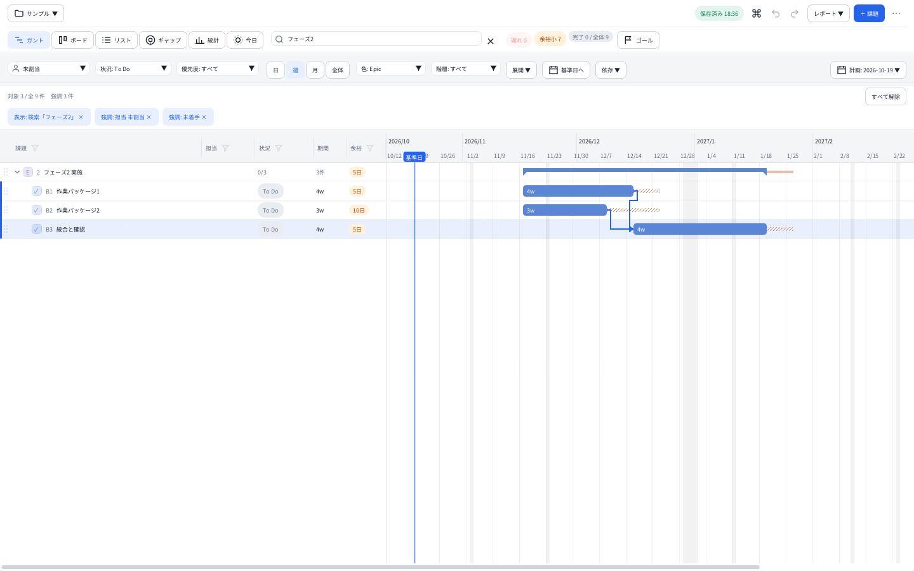

# 使い方

対象: Windows 10/11 x64、Cairn v1.1.0。ダウンロードは [Releases](https://github.com/Hidenori24/cairn/releases)。

## 起動と更新

- インストーラ版: `Cairn-Setup-<版>.exe` を実行します。既定は管理者権限なしで `%LOCALAPPDATA%\Programs\Cairn` に入ります。「すべてのユーザー」を選ぶ場合は管理者権限が必要です。
- ポータブル版: `Cairn-windows-x64.zip` を展開して `Cairn.exe` を実行します。
- 更新: アプリを閉じ、データと設定を控えてから上書きします。インストーラはデータと設定を残します。ポータブル版は既存の `data` と `roadmap_prefs.json` を残してプログラムを更新します。
- 旧称 Project Roadmap から更新しても、データ・設定の場所と名前は引き継ぎます。インストーラは旧 exe とショートカットを消します。zip を同じ場所へ展開した場合は、残った `ProjectRoadmap.exe` を手で消してください。
- アンインストールしてもプロジェクトと `roadmap_prefs.json` は残ります。

現在の公式配布物は未署名です。SmartScreen やブラウザが警告することがあります。公式配布元とチェックサムを確認し、信頼できる場合に実行してください。署名とチェックサムの違いは [リリースと配布](RELEASING.md#コード署名) に記載しています。

## 最初のプロジェクト

1. 初回の「はじめに」から、空のプロジェクト・サンプル・CSV の取り込みを選びます。自動でサンプルを作ることはありません。
2. 既存の CSV は「プロジェクト」メニューの「CSVを取り込む」から追加できます。最低限 `Summary`（件名）列が必要です。UTF-8 と Shift_JIS（CP932）を読み込めます。
3. 「計画: 日付」から基準日・シナリオ・担当者ごとの同時作業の制限を設定します。休業日は「プロジェクト設定」で編集します。
4. 課題に期間と期限を入れ、必要なら先行・後続をつなぎます。日程は営業日で計算します。親課題の日程・期間・完了数は、配下の末端課題から集計します。

期限がなければ余裕は0として表示します。0が必ず遅れを意味するわけではありません。祝日は自動取得しません。既定の休業日は2026年11月〜2028年3月の33日なので、計画の期間・地域に合わせて確認してください。

## 画面と操作

上部1段目はプロジェクト・保存・元に戻す／やり直し・レポート・課題追加・表示倍率・その他、2段目はビュー・検索・遅れ／余裕小の件数・ゴールです。幅が狭いとビューの名前はアイコン表示になります。

| 見たいもの | ビュー |
|---|---|
| 日程・依存・余裕 | ガント（`1`） |
| 状況別の作業 | ボード（`2`） |
| 表形式で編集 | リスト（`3`） |
| ゴールまでの差 | ギャップ（`4`） |
| 集計・負荷・推移・ベースラインとの比較 | 統計（`5`） |
| 今日と今週の作業 | 今日（`6`） |

キーは文字入力中を除きます。行をダブルクリック、`Enter`、`F2` で件名を編集できます。新しく追加した行では `Enter` で確定して次の行を作るため、続けて入力できます。IME の変換確定と編集終了は別の操作です。

| キー | 操作 |
|---|---|
| `N` / `Shift+N` | 同じ階層に追加 / 子を追加 |
| `Tab` / `Shift+Tab` | 階層を下げる / 上げる |
| `Ctrl+クリック` / `Shift+クリック` | 複数選択 / 範囲選択 |
| `Delete` | 選択した課題を削除（子孫も対象） |
| `Ctrl+Z` / `Ctrl+Shift+Z` | 元に戻す / やり直す |
| `Ctrl+K` | コマンドパレット |
| `Ctrl+,` / `?` | アプリの設定 / ショートカット一覧 |

右クリックでも編集操作を選べます。複数選択時はまとめ編集バーから状態・担当・優先度などを変更できます。日程設定や添付・関連リンクの変更は、課題編集の Undo とは扱いが異なります。

## 絞り込みと折りたたみ

- **表示**: 検索と表の列の漏斗は、一致しない課題を隠します。検索は件名・表示ID・キー・ラベル・担当が対象で、祖先が一致すれば配下も対象です。
- **強調**: 上の担当・状況・優先度・遅れ／余裕小は、ほかの課題を薄くします。行は減りません。
- 適用中の条件はチップで表示します。チップで1つずつ解除、「すべて解除」でまとめて解除できます。
- 検索などの表示条件がある間は、一致する課題を見せるため折りたたみを無視して展開します。折りたためないと感じたら、まず条件を解除してください。
- 件数は折りたたみ状態によらず、末端課題（マイルストーンを含む）を数えます。階層表示の制限や非表示ルートによる画面の行数とは一致しない場合があります。
- ギャップ・統計・今日は上部の条件で絞り込みません。それぞれのビュー内の選択を使います。



## 文字が小さいとき

上部の「100% ▼」から125／150／175／200%を選びます。Windows の表示倍率に追加する倍率で、次回も覚えます。`Ctrl+ホイール`、`Ctrl+「+」「-」`、`Ctrl+0`（100%に戻す）やアプリの設定でも変更できます。

ガントの時間軸の上で `Ctrl+ホイール` を使った場合は、時間軸だけを拡大縮小します。

## HTML・週報・PDF

「レポート ▼」から選びます。

- **HTML レポート**: ガント・統計・リストと、出力範囲・色などを指定して保存します。現在表示中のビューをそのまま撮影する機能ではありません。
- **週次レポート**: 今週・先週・任意の期間について Markdown／HTML を出力します。GUI では保存したスナップショットや所感も利用します。
- **CSV・共有用 JSON**: JIRA 用 CSV、アプリ用 CSV、共有 JSON を書き出します。

HTML は画像・スタイルを含む1ファイルです。ガントだけブラウザの横幅を使い、時間軸を約2か月ごとに区切ります。長い計画の後半も出力し、`‹/›` は前後の区間へ続く印です。

PDF にする場合は Edge／Chrome などで HTML を開いて印刷します。用紙は A4、向きは HTML の指定を使います（ガントは横、ほかは縦）。印刷画面で全ページの向きを強制すると指定が上書きされる場合があります。プレビューでページ幅・改ページを確認してください。

## データの場所とバックアップ

既定は exe の隣の `data/projects/`。書き込めない場合は `%LOCALAPPDATA%\ProjectRoadmap\projects\` へ保存します。実際の場所は保存状態のチップから確認できます。

保存先の優先順は `--data <フォルダ>` → 環境変数 `ROADMAP_DATA` → アプリの設定 → 既定です。アプリの設定でコピー付きの切り替えを選んでも、元のファイルは残ります。

```text
Cairn/
  roadmap_prefs.json             端末の設定（書き込めなければ LOCALAPPDATA 側）
  data/projects/
    プロジェクト名/
      project.csv               課題
      project.settings.json     計画・表示・履歴など
      添付/<Issue Id>/           添付の本体
      バックアップ/              最初の上書き前の CSV（最大30個）
    _削除済み/                  削除したプロジェクト
```

**すべて保管するには、アプリを閉じてプロジェクトのフォルダごとコピーしてください。** 端末設定も残すなら、実際に使っている `roadmap_prefs.json` を一緒に控えます。保存先を変更している場合、exe のフォルダだけではデータを含まないことがあります。

| 方法 | 残るもの／用途 |
|---|---|
| 自動の `バックアップ/` | CSV の控え。設定・添付は含まず、すべての編集履歴も残しません |
| 「全プロジェクトをバックアップ」の JSON | 全プロジェクトの CSV・基本設定・テンプレート。添付本体・添付情報・関連リンク・週報の所感／スナップショット・ベースライン・推移の履歴・EVM設定は含みません |
| プロジェクトのフォルダをコピー | CSV・設定・添付・履歴をまとめて保管。`.roadmap.lock` は含めません |

以前の平置きの CSV と設定もそのまま読めます。「アプリの設定」→保存先→「フォルダ構成に移す」で控えを作って移行できます。互換性・ダウングレードの扱いは [COMPAT.md](COMPAT.md)。

## 共有場所と通信

SMB の共有ドライブでは、一人ずつ交代で使うための `.roadmap.lock` を作ります。ほかの人が編集中なら読み取り専用になり、更新が3分ないロックは確認して引き継げます。平置き形式・ロックを知らない古い版との混在・OneDrive や Google Drive の同期フォルダでは保護できません。2台の SMB 実機確認は未実施です。

通常の計画・編集・レポート生成はネット接続不要で、更新確認・利用状況の送信はありません。ただし、次は外部へのアクセスを伴います。

- 関連リンクを開くときはブラウザや関連付けアプリが開きます。
- GitHub の「状態を確認」を押すときは、別途インストール・ログインした GitHub CLI（`gh`）が通信します。起動時の自動取得はしません。「閉じられたら自動で完了」は、状態を確認した後の適用を自動にする設定です。
- 共有ドライブ上のファイルは Windows を介して読み書きします。
